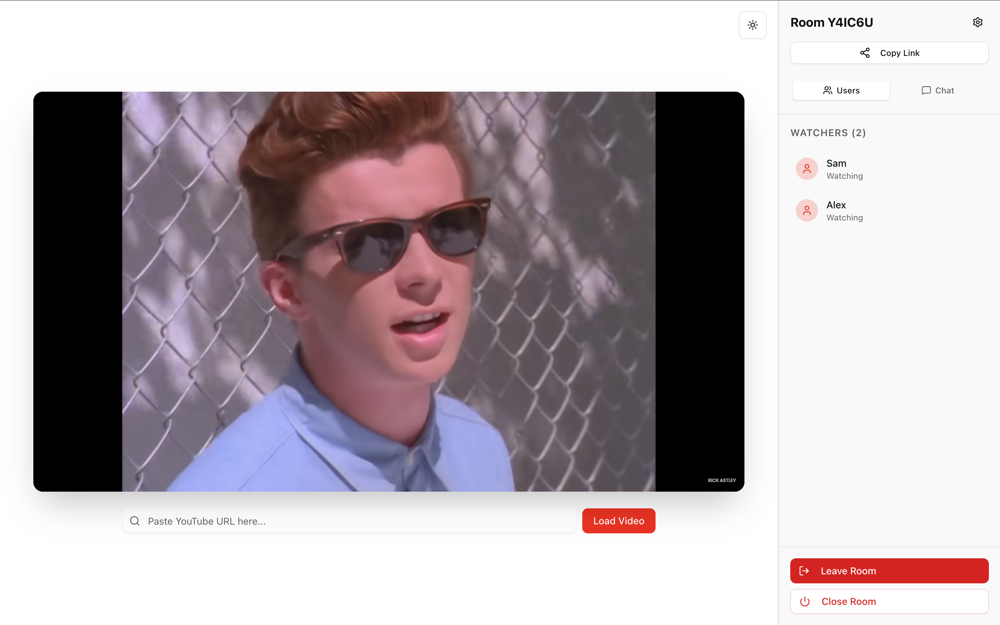
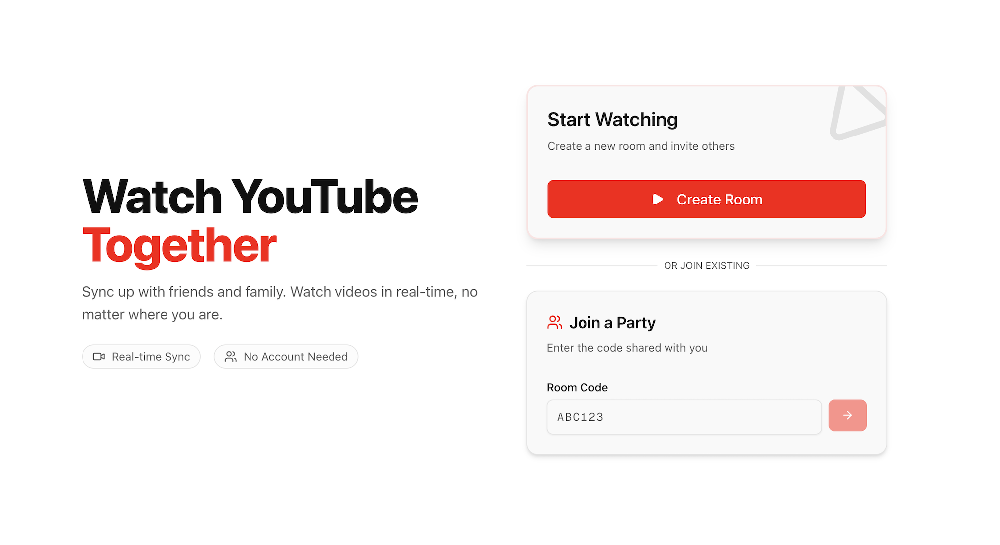

# YTogether

YTogether is a real-time YouTube watch party app. Create a room, share the link, and keep playback synchronized while participants chat and come and go.

## Features

- Shared play, pause, and seek state
- Presence tracking with automatic pause on disconnect
- Six-character room codes with no account required
- Threaded room chat
- Light and dark themes

## Tech stack

- Next.js 16 and React 19
- TypeScript and Tailwind CSS
- Firebase Realtime Database
- YouTube IFrame Player API

## Local setup

1. Install dependencies with `npm install`.
2. Copy `.env.example` to `.env.local` and add your Firebase web app settings.
3. Enable Realtime Database for the Firebase project.
4. Start the app with `npm run dev`.

## Project structure

```text
app/                    Routes and page composition
components/ui/          Shared interface primitives
features/playback/      YouTube loading and playback synchronization
features/room/          Room state, presence, chat, and room UI
features/room-entry/    Create and join flows
lib/                    Shared Firebase and styling setup
```

Room persistence is kept behind `features/room/room-store.ts`; rendering modules do not construct Firebase paths directly. YouTube event details stay inside the playback feature so the room session works with typed playback changes.

## Screenshots



